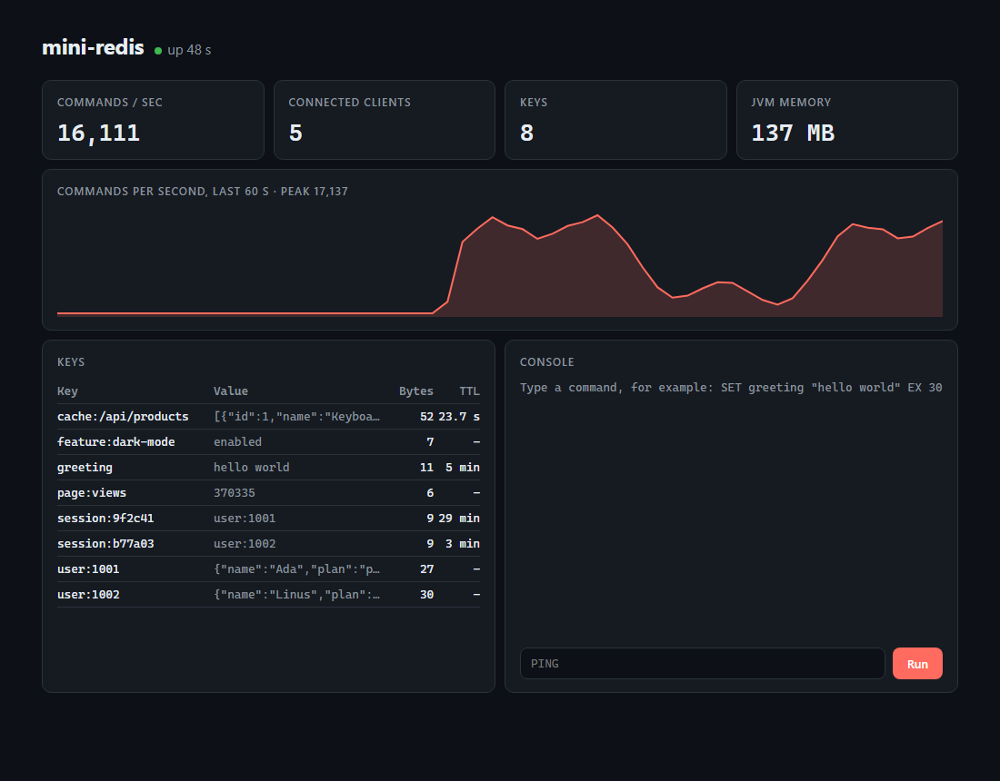

# mini-redis

A Redis-compatible server written from scratch in Java 21. It speaks the real Redis wire
protocol (RESP2), so existing Redis clients can connect to it, and it ships with a live web
dashboard.

No runtime dependencies. Only the JDK.



## Features

- RESP2 parser for array commands and inline commands, binary-safe keys and values
- `PING` `ECHO` `SET` (with `EX`, `PX`, `NX`, `XX`) `GET` `DEL` `EXISTS` `INCR` `DECR` `INCRBY`
  `DECRBY` `EXPIRE` `PEXPIRE` `TTL` `PTTL` `PERSIST` `KEYS` `DBSIZE` `FLUSHALL` `INFO`
- Key expiry, both lazy (on access) and active (background sweep)
- Pipelining: a batch of commands is answered with a single network write
- One virtual thread per connection
- Dashboard with throughput chart, key browser and command console

## Run

Requires JDK 21 and Maven.

```bash
mvn package
```

```bash
java -jar target/mini-redis-1.0.0.jar
```

The server listens on `127.0.0.1:6379` and the dashboard on <http://127.0.0.1:8080>.
Both ports can be changed: `java -jar target/mini-redis-1.0.0.jar 6380 8081`.

Any Redis client works:

```
$ redis-cli
127.0.0.1:6379> SET session:42 alice EX 60
OK
127.0.0.1:6379> TTL session:42
(integer) 60
127.0.0.1:6379> INCR page:views
(integer) 1
```

## Design

```
Server      accepts connections, one virtual thread each
  Resp      decodes commands from bytes, encodes replies
  Commands  validates arguments, calls the store, writes the reply
  Store     ConcurrentHashMap of key -> (value, expiry time)
Dashboard   JDK HttpServer exposing stats, keys and a console
```

## Details that were not obvious

- **Atomic commands without a global lock.** Real Redis is single threaded, which makes every
  command atomic for free. This server is multi threaded, so `INCR` and `SET NX` run inside
  `ConcurrentHashMap.compute`, which locks only the affected key. A test hammers one counter
  from 8 connections and checks that no increment is lost.
- **Two kinds of expiry.** Checking the deadline on every read is not enough: a key that is
  never read again would stay in memory forever. A background task removes those.
- **Pipelining.** Replies are buffered while more input is already waiting and flushed once
  the input runs dry. Flushing after every command would cost one system call per command.
- **Binary safety.** Bulk strings are length-prefixed, so a value may contain `\r\n` or any
  other byte. Keys are stored as ISO-8859-1 strings because that charset maps every byte to
  exactly one character and back.
- **The Turkish "I" problem.** Command names are case-insensitive. With a Turkish default
  locale, `"ping".toUpperCase()` returns `"PİNG"` and the command is not recognised. The
  server uses `Locale.ROOT`, and a test runs under `tr-TR` to prove it.
- **Reply injection.** The "unknown command" error echoes the client's input. Control
  characters are stripped first, otherwise a command name containing `\r\n` could forge a
  second reply and desynchronise the client.
- **Untrusted lengths.** A client can claim a bulk string is 2 GB long. Lengths are capped
  before any memory is allocated.
- **Dashboard and CSRF.** The console endpoint requires a custom header. Browsers refuse to
  send custom headers cross-origin without a CORS preflight, so another website cannot run
  commands against the local server.

## Tests

```bash
mvn test
```

25 tests in three groups: protocol parsing (including malformed and truncated input), the
store with a fake clock (expiry is tested without sleeping), and integration tests that talk
to a running server over TCP.

## Limitations

- Strings only. No lists, hashes, sets or sorted sets.
- No persistence, replication, transactions, pub/sub or `AUTH`. Because there is no `AUTH`,
  the server binds to the loopback interface only.
- RESP2 only.
- Active expiry scans the whole keyspace once a second. Redis samples random keys instead,
  which scales better.

## License

MIT
